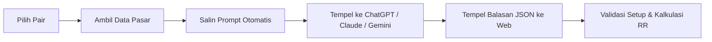

# 📈 TRADING-ANALISIS-FREE-MOBILE
> **Mobile Quant Technical Analyzer & AI Prompt Generator (Zero AI Token Edition)**

Aplikasi web mobile ultra-ringan untuk analisis teknikal pasar Forex dan Gold (XAU/USD). Dirancang khusus untuk menghasilkan data struktur harga multi-timeframe terformat dan prompt cerdas siap pakai ke AI browser (ChatGPT, Claude, Gemini) **tanpa memerlukan saldo API / kuota token AI berbayar**.

🔗 **Live Web App:** [ashtersai.github.io/TRADING-ANALISIS-FREE-MOBILE](https://ashtersai.github.io/TRADING-ANALISIS-FREE-MOBILE/)

---

## ✨ Fitur Unggulan

- **Zero AI Token Cost:** Pemrosesan data pasar dilakukan di sisi browser. Hasil dikirim langsung ke AI browser favorit Anda lewat satu kali klik salin (*Copy to Clipboard*).
- **Multi-Timeframe Structure (MTF):** Menganalisis pasar menggunakan hierarki institusional:
  - **D1 / H4:** Tren dominan & level Major Support/Resistance.
  - **H1:** Struktur market (*Swing HH/HL/LH/LL, BOS, CHoCH*).
  - **M15:** Area *entry*, *breakout/retest*, dan konfirmasi penutupan candle (*completed candle close*).
- **Twelve Data API Integration:** Menarik harga terkini dan histori pasar secara langsung dan akurat.
- **Mode Simulasi Offline:** Tetap dapat digunakan untuk latihan dan pengujian prompt tanpa perlu memasukkan API key.
- **Rule Strict Pending Orders:** Format instruksi mengunci AI agar hanya merekomendasikan *Pending Order* (*BUY STOP, SELL STOP, BUY LIMIT, SELL LIMIT*) dengan rasio **Risk-to-Reward (RR) minimal 1:2**.
- **Validator Respon AI & Kalkulator RR:** Dilengkapi parser lokal untuk memverifikasi validitas JSON balasan AI dan menghitung kepatuhan rasio RR secara otomatis.
- **Mobile-First & Private:** Dioptimalkan untuk layar smartphone Android/iOS. API Key disimpan secara lokal di `localStorage` perangkat dan tidak dikirim ke server pihak ketiga mana pun.

---
## 🚀 Alur Kerja (Workflow)

Berikut adalah tahapan penggunaan aplikasi:



### 📌 Langkah Penggunaan

1. **Pilih Instrumen:** Pilih pair yang ingin dianalisis, misalnya `XAU/USD` atau `EUR/USD`.
2. **Ambil Data:** Klik tombol **Ambil Data** untuk mengambil harga terkini melalui Twelve Data atau menggunakan Mode Simulasi.
3. **Salin Prompt:** Klik tombol **📋 SALIN KE CLIPBOARD** untuk menyalin prompt analisis secara otomatis.
4. **Jalankan di AI:** Buka ChatGPT, Claude, atau Gemini, kemudian tempel prompt menggunakan `Ctrl + V`.
5. **Validasi Setup:** Salin hasil analisis AI dalam format JSON, kemudian tempel ke kolom **Validasi Balasan AI** pada aplikasi.
6. **Kalkulasi RR:** Sistem akan memvalidasi setup dan menghitung rasio Risk/Reward secara otomatis.

**Catatan:** Setup dinyatakan valid apabila memenuhi rasio Risk/Reward minimal 1:2.

---

## 🛠️ Format Standar JSON Balasan AI

AI akan menghasilkan respons dalam format JSON terstruktur dengan penjelasan berbahasa Indonesia.

### Contoh Respons

```json
{
  "instrument": "XAU/USD",
  "signal": "BUY STOP",
  "entry": 2745.50,
  "sl": 2738.00,
  "tp": 2761.00,
  "warningLevel": 2742.00,
  "biasReversalLevel": 2735.00,
  "status": "VALID SETUP",
  "reason": "Breakout resistance H1 didukung kelanjutan tren D1 di atas EMA20.",
  "confirmationCondition": "Candle M15 close di atas level 2745.50 dengan momentum bersih.",
  "cancellationCondition": "Harga drop dan close kembali di bawah 2738.00 sebelum entry terpicu."
}
```

### 📖 Keterangan Field JSON

| Field | Keterangan |
|---|---|
| `instrument` | Instrumen trading yang dianalisis. |
| `signal` | Jenis sinyal trading, seperti BUY STOP, SELL STOP, BUY LIMIT, SELL LIMIT, atau WAIT. |
| `entry` | Harga rencana masuk posisi. |
| `sl` | Harga Stop Loss. |
| `tp` | Harga Take Profit. |
| `warningLevel` | Level harga untuk peringatan risiko. |
| `biasReversalLevel` | Level harga yang mengindikasikan perubahan arah bias. |
| `status` | Status validitas setup trading. |
| `reason` | Alasan teknikal di balik keputusan AI. |
| `confirmationCondition` | Kondisi yang harus terpenuhi sebelum entry. |
| `cancellationCondition` | Kondisi yang membatalkan setup trading. |

**Penting:** Respons AI harus mengikuti struktur JSON tersebut agar dapat dibaca dan divalidasi oleh sistem. Jangan menambahkan teks, komentar, atau Markdown di luar objek JSON saat mengirimkan hasil analisis ke aplikasi.
⚙️ Pemasangan & Penggunaan Mandiri
Repositori ini murni menggunakan HTML5, CSS3 murni, dan Vanilla JavaScript tanpa dependencies pihak ketiga (Node.js/npm tidak diperlukan):

Clone repository:

Bash
git clone [https://github.com/ashtersai/TRADING-ANALISIS-FREE-MOBILE.git](https://github.com/ashtersai/TRADING-ANALISIS-FREE-MOBILE.git)
Jalankan:
Cukup klik dua kali berkas index.html untuk membuka di browser apa pun, atau aktifkan GitHub Pages di repositori Anda.

⚠️ Disclaimer
Aplikasi ini dibuat murni untuk tujuan analisis teknikal, edukasi strategi, dan prompt engineering. Segala keputusan eksekusi order trading di pasar finansial merupakan tanggung jawab penuh masing-masing individu. Selalu terapkan manajemen risiko yang ketat.
